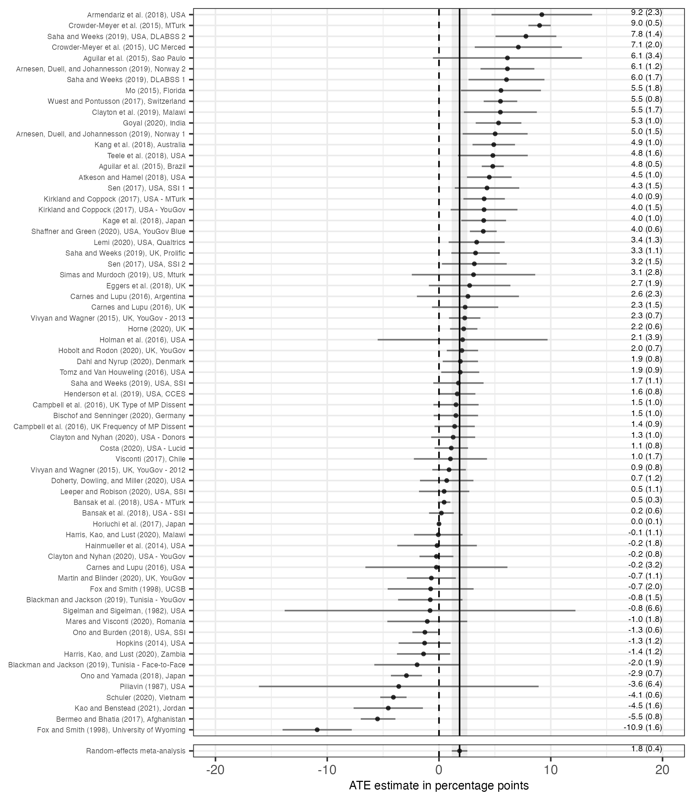
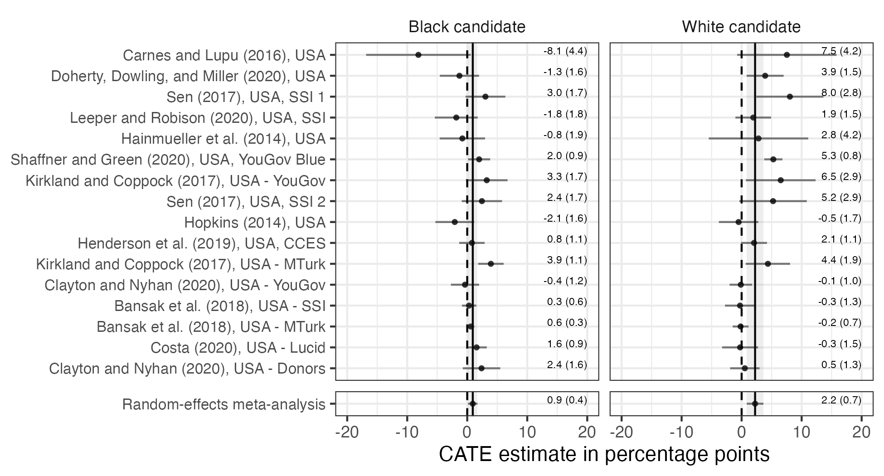
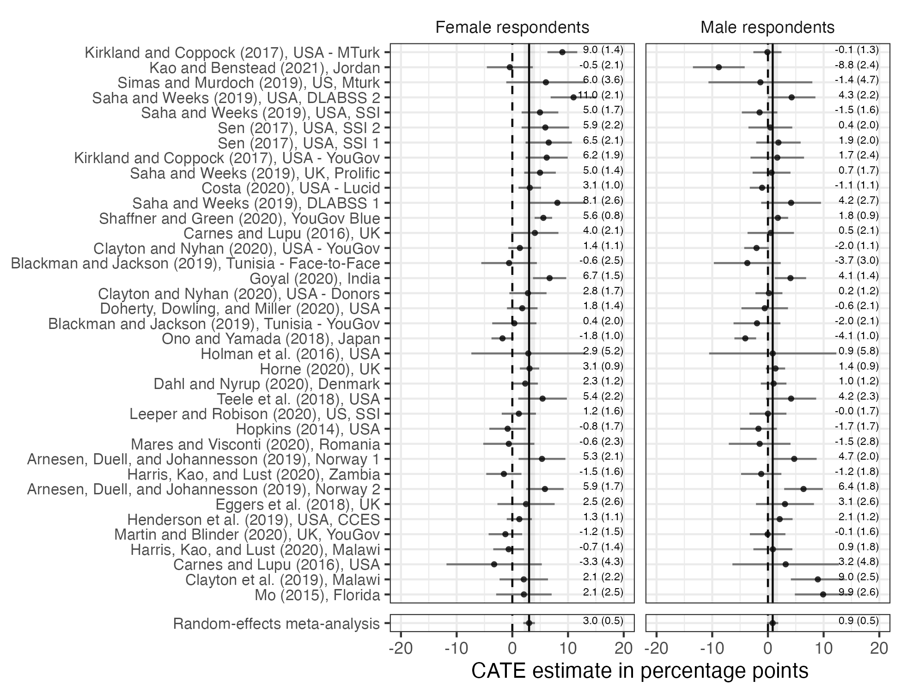
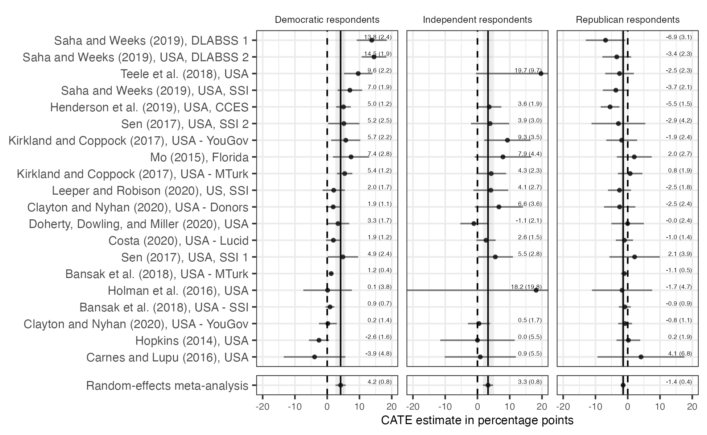
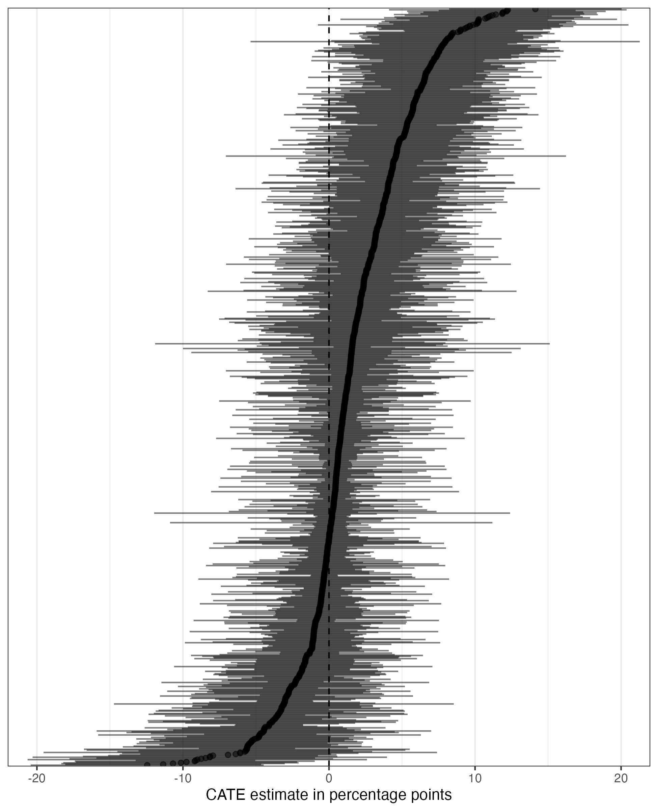

# Active Maintenance Report: schwarz_coppock_2022

2026-08-01

- [Summary](#summary)
  - [Does the deposited archive run?](#does-the-deposited-archive-run)
  - [Does the maintained rewrite reproduce the
    paper?](#does-the-maintained-rewrite-reproduce-the-paper)
- [Paper overview](#paper-overview)
- [Original archive reproducibility](#original-archive-reproducibility)
- [Errata](#errata)
- [Ground truth](#ground-truth)
- [Every published number](#every-published-number)
- [Maintained rewrite](#maintained-rewrite)
- [Figures](#figures)
- [Rewrite verification](#rewrite-verification)
- [R environment](#r-environment)

*Drafted by Claude Opus 5 under the supervision of Alex Coppock.*

This repository holds the actively maintained replication code for
Schwarz and Coppock (2022), together with the reproducibility report
that documents what the original archive did and did not do. It is part
of a program applying the maintenance proposal in Peer, Orr and Coppock
(2021, *PS: Political Science & Politics*, doi
[10.1017/S1049096521000366](https://doi.org/10.1017/S1049096521000366))
to a set of published archives.

|  |  |
|----|----|
| Article | [10.1086/716290](https://doi.org/10.1086/716290) |
| Replication archive | [10.7910/DVN/R27ULT](https://doi.org/10.7910/DVN/R27ULT) |

**The data are not redistributed here.** The deposit is 0.5 MB across 12
files and lives at Harvard Dataverse, which is the only copy this
repository points at. `download_original.R` fetches it and verifies
every file; `original_manifest.csv` pins the file identifiers, sizes and
checksums, so the exact bytes this code was written against are recorded
in version control even though the bytes themselves are not.

**Repository layout.** `maintained/` is the maintained rewrite: one
script per published table or figure, writing to `output/`, which is
committed so a reader can compare a fresh run against it without
downloading anything. `ground_truth/` ties every published number to the
code that produces it. `original/` is created by the download script and
is deliberately absent from the repository. This file is the
reproducibility report, also available as a PDF in `report/`.

**License.** CC0 1.0 Universal, matching the terms of the deposit this
repository maintains. See `LICENSE`.

**To reproduce.** Clone or download the repository, open
`schwarz_coppock_2022.Rproj`, and run:

``` r
source("run_all.R")
```

That fetches the deposit, verifies its 12 files, and produces every
table and figure into `maintained/output/`. Required packages:
tidyverse, metafor, knitr, kableExtra, here. Paths resolve through
`here`, so nothing depends on the working directory. The full run takes
about six seconds. A successful run overwrites `maintained/output/`,
which is committed: **`git diff` on that folder is the reproduction
check.**

# Summary

Two questions, answered before the detail.

## Does the deposited archive run?

Yes, completely. All five analysis scripts execute without error on a
current R installation. There are no `setwd()` calls, no hardcoded
absolute paths and no functions called before they are defined, and
every package the scripts name still installs from CRAN, `rmeta` and
`ggstance` included. Nothing in the deposit needs a substitution to run.

What the archive does not do is write anything. All eight `ggsave()`
calls, all three `print.xtable()` calls and the single `sink()` block
are commented out in the deposited files, so a clean run leaves nothing
behind but a stray `Rplots.pdf` from the plots being printed to a
device. There is nothing to diff a rerun against, which is why the
maintained rewrite writes its outputs to disk.

## Does the maintained rewrite reproduce the paper?

Mostly, and the exceptions are mostly in the article rather than in the
code. Every number the article and its appendix print has been extracted
by hand into `ground_truth/published_claims.csv`, 2,624 of them, and
2,587 reproduce exactly at the precision the page uses. 15 disagree and
22 have no counterpart in the deposit at all.

Most of that total is float cells that a reader would not think of as a
table. The four forest plots print an estimate and a standard error
beside **every** row, not only beside the pooled summary, which is 472
published numbers; the 44 per-study appendix figures do the same, which
is another 1,888; and Table 1 prints subject and rating counts for each
of the 67 studies, which is 136 more. All of those reproduce but two.

The disagreements, none of which changes a substantive conclusion:

| Claim | Article | Deposit | Where the fault lies |
|:---|:---|:---|:---|
| figure_3 :: female :: sen_2 :: estimate | 6.0 | 5.9 | archive |
| figure_3 :: male :: sen_2 :: estimate | 0.5 | 0.4 | archive |
| table_2 :: trimmed :: label_percent | 90 | 91 | unresolved |
| theory :: share_positive_fraction | 0.75 | 0.701 | paper_internal |
| design :: n_papers | 49 | 50 | unresolved |
| results :: n_positive_significant | 23 | 29 | unresolved |
| results :: n_negative | 18 | 19 | paper_internal |
| results :: n_negative_significant | 11 | 6 | unresolved |
| results :: trim_percent | 5 | 3.0 and 6.0 | unresolved |
| results :: n_resp_gender_studies | 36 | 37 | paper_internal |
| discussion :: share_positive_fraction | 0.75 | 0.701 | paper_internal |
| table_a1 :: n_studies_listed | 43 | 44 | paper_internal |
| appendix_b :: n_digitally_measured_experiments | 9 | 10 | unresolved |
| appendix_b :: n_digitally_measured_papers | 7 | 8 | unresolved |
| figure_a18 :: printed_estimates | 0 | 10 | paper_internal |

Published numbers the deposit does not reproduce.

6 are the article contradicting its own data. Five of those are in
`errata.qmd`, which renders to `schwarz_coppock_2022_errata.pdf` and
sets out five numbered items, four of them computed from the deposit at
render time and one a reference-list correction the deposit cannot
reach; the sixth is the row count of appendix Table A.1, which is a
defect in a table rather than in a sentence and is described below. 2
are the deposit disagreeing with the page. The remaining 7 are
unresolved, in the strict sense that the cause cannot be established
from the deposit and guessing at one would be worse than saying so.

**One published figure prints no data at all.** Appendix Figure A.18 is
Costa (2020), whose randomized attribute levels are whole tweets. At the
width the appendix uses, those row labels push the plotting panel, the
points, the intervals, the estimate labels and the axis off the right
edge of the page, so the published figure shows a column of truncated
sentences, an axis title cut off after four letters, and none of its ten
estimates. The deposited code reproduces the defect exactly, which is
why the maintained `figure_a18_costa_1.pdf` looks the same;
`figure_a18_costa_1_legible.pdf` is the same ten estimates redrawn so
they can be read, and it is what the errata reprints.

**The significance counts reproduce under no rule.** The article reports
that of the 67 estimates, “47 are positive (23 significant) and 18 are
negative (11 significant).” The rule the deposited script itself
applies, a confidence interval excluding zero, gives 29 and 6. Testing p
below 0.05 gives 19 and 2, and cannot be what was done in any case,
because 19 of the 67 rows carry no p-value at all. Nor is this a matter
of finding the right threshold: both counts rise as a threshold is
relaxed, so no threshold produces 23 and 11 together. The threshold that
puts 23 estimates in the positive column leaves 5 in the negative one,
and the threshold that reaches 11 in the negative column leaves 43 in
the positive one. No corrected value can be stated, so none is; this is
recorded as unresolved rather than as an erratum.

Every estimate, standard error, interval and p-value the article reports
in prose reproduces exactly. What fails is a set of hand-counted
descriptions of those estimates, plus two cells of one appendix figure.

# Paper overview

**Citation**: Schwarz, S. and Coppock, A. (2022). “What Have We Learned
about Gender from Candidate Choice Experiments? A Meta-Analysis of
Sixty-Seven Factorial Survey Experiments.” *The Journal of Politics*,
84(2), 655-668. DOI: 10.1086/716290

**Summary**: Sixty-seven conjoint and factorial candidate choice survey
experiments, fielded between 1982 and 2021 in more than twenty
countries, all randomized candidate gender alongside other candidate
attributes. Each study’s treatment effect of being described as a woman
is re-estimated on a common footing and the 67 estimates are pooled by
random-effects meta-analysis. The pooled effect is a gain of 1.8
percentage points of vote share for women candidates, with a confidence
interval from 1.1 to 2.5 points. The effect is larger for white than for
Black candidates in the US context (2.2 against 0.9 points), larger
among women respondents than men (3.0 against 0.9), and reverses sign
among Republicans (-1.4) while running positive among Democrats (4.2)
and Independents (3.3).

**What the deposit contains**: five pre-computed summary datasets and
five analysis scripts. The individual-level data belong to the authors
of the 67 original studies and are not redistributed, so the deposit
begins one level up, at estimated ATEs and CATEs with their standard
errors. Every number in the article is a function of those five files.

# Original archive reproducibility

| Script | Status on current R | Resolution |
|:---|:---|:---|
| helpers.R | Clean (sourced by all five scripts) | No changes required |
| meta_analyze_sates.R | Runs; writes nothing, every output call is commented out | No changes required |
| meta_analyze_cates_cand_race.R | Runs; writes nothing | No changes required |
| meta_analyze_cates_resp_gender.R | Runs; writes nothing | No changes required |
| meta_analyze_cates_resp_pid.R | Runs; writes nothing. Reports the Independent-Republican p-value from the Democrat-Republican statistic | Corrected in the rewrite; see Errata |
| meta_analyze_cates_cand_attributes.R | Runs; writes nothing. Its per-study figure loop is written but its writes are commented out | Restored in the rewrite as 44 written figures |

The deposited scripts on a current R installation.

Nothing here needs fixing to make the archive run. The deprecations are
all warnings rather than errors: `geom_errorbarh()` and the `%+%`
operator are deprecated in ggplot2 4.0.0 but still work,
`reshape2::melt()` and `dcast()` are superseded, and `dplyr::do()` has
been superseded since 1.0.0. What is wrong with this archive is the
p-value bug documented in the Errata, which is a logic error rather than
a run failure.

**`rmeta` and `ggstance` are both still installable.** The maintained
rewrite replaces `rmeta::meta.summaries()` with `metafor::rma()` on
maintenance grounds rather than availability grounds: `rmeta` has not
been updated since March 2018. The two implementations of
DerSimonian-Laird agree on every pooled estimate, standard error and
interval bound in the paper to more than ten significant figures.
`ggstance::position_dodgev()` resolves without incident from ggstance
0.3.7, which `coefplot` pulls in. It is dropped from the rewrite for a
different reason: it is inert. Building the layer with and without it
puts every point at the same coordinates, because every y value it is
asked to dodge is already unique, 954 distinct labels across 954 rows in
Figure A.1 and no repeated label within any study in Figures A.2 through
A.45.

**What the archive does not produce.** Every write in the deposit is
commented out: eight `ggsave()` calls, three `print.xtable()` calls and
one `sink()` block. Two of the commented `ggsave()` paths point at a
directory that was never part of the deposit
(`04_Drafts/current_draft/figures/`). The consequence is that the
deposit cannot be checked against itself. There is no committed output
to diff a rerun against, and a reader who runs all five scripts sees
console output and a `Rplots.pdf` and nothing else. Restoring those
writes, so that a rerun can be compared against a committed result, is
the single largest change the maintained rewrite makes.

# Errata

This section documents corrections the maintained rewrite makes to the
deposited code. Errors in the article itself are a separate document:
`errata.qmd`, which renders to `schwarz_coppock_2022_errata.pdf`, sets
out the five corrections one by one, with each of the four numeric ones
computed from the deposit at render time. The one other is
bibliographic: a sweep of all 119 printed references against Crossref
drew a single flag and it is real, the entry for the Clayton and Nyhan
(2020) manuscript naming two of its six authors. The manuscript at the
URL that entry itself prints is by Carey, Clayton, Helmke, Nyhan,
Sanders and Stokes, so the short form the article uses as a study label
in Table 1, the appendix study table and Figures A.16 and A.17 should
read Carey et al. (2020). No estimate or sample size is affected.

**The Independent-versus-Republican p-value is computed from the wrong
statistic.** In `meta_analyze_cates_resp_pid.R`, the block that tests
the two differences between pooled partisan CATEs computes the second
p-value from the first test’s statistic:

``` r
# Archive:
I_R_statistic = I_R_estimate / I_R_std.error,
I_R_p.value = 2 * pnorm(abs(D_R_statistic), lower.tail = FALSE)

# Rewrite:
I_R_p.value = 2 * pnorm(abs(I_R_statistic), lower.tail = FALSE)
```

`I_R_statistic` is computed on the line above and then never used, so
the reported Independent-Republican p-value is numerically identical to
the Democrat-Republican one.

| Quantity | Published | Original archive | Maintained rewrite |
|----|----|----|----|
| Independent minus Republican, p | not reported | 2.21e-10 (equals the D-R p-value) | 1.06e-07 |

The article states only that “the Republican estimate is statistically
significantly different from the Democratic and Independent estimates,”
which is true of both the wrong value and the right one. No published
number changes.

**Not corrected: the trimming rule.** Table 2’s last-but-one row is
labelled “Trimmed (middle 90% of estimates)” and the text says the row
drops “the bottom and top 5% of point estimates.” The code keeps
estimates above the 2nd percentile and below the 95th, which drops the
bottom 3.0 per cent and the top 6.0 per cent and retains 61 of 67
studies, or 91 per cent rather than 90. Correcting 0.02 to 0.05 would be
a plausible reading of a typo, but it is a change to a sample definition
rather than to a mechanical error, so the rewrite reproduces the
published row as computed and reports the alternative separately in
`output/table_2_trim_sensitivity.csv`. The symmetric rule the text
describes gives 0.020 over 59 studies against the published 0.018 over
61, so the robustness claim the row is making survives either reading.

**Not corrected: the year threshold.** The subset labelled “Post-2014
studies” is selected by `year > 2010`. The labels are nonetheless
accurate, because the sample contains no study fielded between 1998 and
2014, a gap the article notes in its fourth footnote, so every threshold
in that window produces the same two groups of 63 and 4.

# Ground truth

| Table or figure | Reproduces | Not stated in the article | Does not reproduce |
|:----------------|-----------:|--------------------------:|-------------------:|
| figure_1        |          5 |                         0 |                  0 |
| figure_2        |          6 |                         5 |                  0 |
| figure_3        |          6 |                         5 |                  1 |
| figure_4        |          7 |                         8 |                  0 |
| figure_a1       |          3 |                         0 |                  0 |
| table_1         |          3 |                         1 |                  0 |
| table_2         |         40 |                         1 |                  0 |
| table_a1        |          0 |                         0 |                  1 |
| text            |          2 |                         2 |                  4 |

Ground truth: 100 recorded quantities, by where the article states them.

`ground_truth/schwarz_coppock_2022_ground_truth.csv` records 100
quantities and answers a question about the deposited code:
`value_script` is what the deposited scripts produce through `rmeta`,
`value_rewrite` is what `maintained/` produces through `metafor`, and
`value_paper` is filled only by reading the article. Where the article
does not state a quantity the cell is empty and `match` is `NA`, which
is the case for every confidence interval bound in the four figures: the
forest plots draw the intervals but label only the estimate and its
standard error.

The article’s own side of the comparison is exhaustive and lives
separately, in the next section.

| Table or figure | Claim | Article | Deposit | Note |
|:---|:---|:---|:---|:---|
| text | n_negative | 18 | 19 | Text: 18 are negative. The deposit has 19 negative, one exactly zero and 47 positive, which sums to 67; the published 47 plus 18 sums to 65 |
| text | n_pos_and_sig_ci_rule | 23 | 29 | Text: 47 estimates are positive (23 significant). No significance rule the deposit supports gives 23. Both counts rise as a threshold is relaxed, so no threshold gives 23 and 11 at once: the interval rule the archive uses gives 29 and 6, and reaching 11 negative would leave 44 positive |
| text | n_neg_and_sig_ci_rule | 11 | 6 | Text: 18 are negative (11 significant). The archive’s interval rule gives 6 and no rule reaches 11; see the note on the positive count |
| text | prop_positive | 0.75 | 0.7014925373134329 | Discussion states more than three-fourths of the studies show a positive effect. value_paper records that lower bound rather than an equality; 47 of 67 is 0.701, so the claim does not hold |
| figure_3 | n_studies_in_text | 36 | 37 | Text: for the 36 experiments where we were able to identify respondent gender. The deposit and the paper’s own figure both have 37 |
| table_a1 | n_studies_listed | 43 | 44 | Published Table A.1 lists 43 studies. Simas and Murdoch (2019) has a CATE figure at A.44 but no Table A.1 row |

The 6 recorded quantities that do not reproduce.

# Every published number

The ground truth above was built around the article’s floats. That
misses the numbers a reader is most likely to quote, which sit in
sentences, and it misses the numbers a figure prints on its own face. So
the article and its appendix were read end to end and every numeric
token extracted by hand into `ground_truth/published_claims.csv`: 2,624
of them, each classified by what would verify it.

| What would verify it                              | Claims |
|:--------------------------------------------------|-------:|
| Pipeline: the deposit should produce it           |   2585 |
| Descriptive: a claim about shape, sign or a count |     13 |
| Transcribed: copied from another paper            |     13 |
| Definitional: a scale point or a design parameter |      7 |
| Structural: a float’s own shape                   |      6 |

The 2,624 numbers the article and appendix print.

Two instruments read those claims against the pipeline, by separate
paths from the same outputs. `ground_truth/build_ground_truth.R` writes
`ground_truth/published_claims_reproduction.csv`, which puts the
pipeline’s value beside every published one;
`maintained/in_text_claims.R` prints each number beneath the sentence
that states it, quoted verbatim. Where one parses the label a plot or a
table actually draws, the other formats the estimate behind it. The
build runs the claims file, counts what it prints against the
extraction, and stops if the two instruments disagree anywhere, so
neither can quietly stop checking.

| Where the article prints it | Claims | Reproduces | Does not | No counterpart |
|:----------------------------|-------:|-----------:|---------:|---------------:|
| abstract                    |      2 |          2 |        0 |              0 |
| appendix_a                  |      1 |          0 |        0 |              1 |
| appendix_b                  |      5 |          0 |        2 |              3 |
| design                      |     12 |          9 |        1 |              2 |
| discussion                  |      7 |          4 |        1 |              2 |
| figure_1                    |    137 |        137 |        0 |              0 |
| figure_2                    |     68 |         68 |        0 |              0 |
| figure_3                    |    152 |        150 |        2 |              0 |
| figure_4                    |    116 |        116 |        0 |              0 |
| figure_a1                   |      1 |          1 |        0 |              0 |
| figure_a2 to figure_a45     |   1889 |       1888 |        1 |              0 |
| intro                       |     11 |          4 |        0 |              7 |
| results                     |     34 |         29 |        5 |              0 |
| table_1                     |    136 |        136 |        0 |              0 |
| table_2                     |     41 |         40 |        1 |              0 |
| table_a1                    |      1 |          0 |        1 |              0 |
| theory                      |     10 |          2 |        1 |              7 |
| title                       |      1 |          1 |        0 |              0 |

Published numbers against the deposit, by where the article prints them.

**Every forest plot in the paper is a published table in disguise.**
Each prints an estimate and a standard error, in percentage points to
one decimal, beside every study row and not only beside the pooled
summary. In the four main figures that is 472 numbers, and in the 44
per-study appendix figures another 1,888. The four main figures are
rasterized in the published PDF, so no text search reaches them; they
were read off page renderings. All but two reproduce, and the two are
both Sen (2017), USA, SSI 2 in Figure 3, where the page prints 6.0 and
0.5 and the deposited respondent-gender file gives 5.9 and 0.4. The
deposited study-level file does carry a revised Sen SSI 2 estimate,
which Figure 1 reproduces exactly, so the conditional-effects file is
one revision behind the figure the article printed. Every one of the
1,888 appendix labels reproduces exactly.

**The deposit has no counterpart for 22 published numbers**, each named
with its reason in `build_ground_truth.R`. Twelve are quoted from other
people’s papers and cannot drift when this pipeline moves. Two are
theoretical reference points, a majority threshold and the midpoint of a
vote margin. Three are the appendix B validation of the digital
measurement procedure, whose average absolute error and correlation
compare digital measurements against estimates computed from Kirkland
and Coppock’s raw data; the deposit carries neither, so those numbers
are not reconstructible from it. What the deposit does record is which
studies were measured that way, in a free-text note field: the note
marks ten experiments in eight papers where the appendix says nine in
seven.

**Two further disagreements the float-shaped ground truth could not
see.** The design section says the 67 experiments come from 49 papers,
where the deposit assigns 50 distinct bibliography keys to them. And
Table 2’s trimmed row, labelled “middle 90% of estimates” and described
in the text as dropping “the bottom and top 5% of point estimates,” in
fact drops the bottom 3.0 per cent and the top 6.0 per cent, retaining
61 of 67. Both are recorded as unresolved: the deposit is
self-consistent in each case and cannot say which of the two readings
was intended.

# Maintained rewrite

| Script | Output |
|:---|:---|
| helpers.R | Packages, re_meta(), diff_test(), label formatting |
| table_1_study_manifest.R | table_1_study_manifest.csv |
| table_2_meta_robustness.R | table_2_meta_robustness.csv, table_2_trim_sensitivity.csv |
| table_a1_study_attributes.R | table_a1_study_attributes.csv |
| figure_1_sate_forest_plot.R | figure_1_sate_forest_plot.pdf and .png, figure_1_meta_summary.csv, figure_1_plotted_estimates.csv |
| figure_2_cate_candidate_race.R | figure_2_cate_candidate_race.pdf and .png, figure_2_meta_summary.csv, figure_2_diff_in_cates_cand_race.csv, figure_2_plotted_estimates.csv |
| figure_3_cate_respondent_gender.R | figure_3_cate_respondent_gender.pdf and .png, figure_3_meta_summary.csv, figure_3_diff_in_cates_resp_gender.csv, figure_3_plotted_estimates.csv |
| figure_4_cate_respondent_pid.R | figure_4_cate_respondent_pid.pdf and .png, figure_4_meta_summary.csv, figure_4_diff_in_cates_resp_pid.csv, figure_4_plotted_estimates.csv |
| figure_a1_cate_candidate_attributes.R | figure_a1_cate_candidate_attributes.pdf and .png, figure_a1_cate_summary.csv |
| figure_a2_a45_cate_by_study.R | 44 per-study appendix figures, figure_a2_a45_index.csv |
| text_in_text_numbers.R | text_in_text_numbers.csv, text_study_level.csv |
| in_text_claims.R | Printed only: every published number beneath the sentence that states it |

The maintained rewrite.

**Substitutions.**

| Deposited | Maintained | Why |
|----|----|----|
| `rmeta::meta.summaries(method = "random")` | `metafor::rma(method = "DL")` | Same DerSimonian-Laird estimator; `rmeta` last updated 2018 |
| `do(tidy(with(., ...)))` | `group_by() \|> reframe(re_meta(...))` | `do()` superseded in dplyr 1.0.0 |
| `reshape2::melt()` and `dcast()` | `pivot_wider()`, or dropped | The melt-dcast-clean_names round trip existed only to line two pooled rows up side by side |
| `geom_errorbarh(height = 0)` | `geom_linerange()` | Deprecated in ggplot2 4.0.0 |
| `ggstance::position_dodgev()` | dropped | Still available, but inert: every y value it dodges is already unique |
| `ggplot() %+% data` | `ggplot(data)` | Deprecated in ggplot2 4.0.0 |
| commented-out `ggsave()`, `print.xtable()`, `sink()` | `ggsave()` and `write_csv()` to `output/` | So that a rerun can be diffed against a committed result |
| `%>%` | `\|>` | Native pipe |

**The estimator is named at every call site.** `re_meta()` in
`helpers.R` takes `method` as a required argument rather than defaulting
to `DL`, so no script can pool without saying which estimator it pooled
with. `table_2_meta_robustness.R` reports both: the DL columns reproduce
the published table, and REML columns sit beside them as an addition
rather than a correction. REML moves no estimate by more than 0.001 and
widens most intervals slightly, which is what a different heterogeneity
estimator on 67 studies should do.

**Coverage the archive states but does not deliver.** The deposit’s
README says `meta_analyze_cates_cand_attributes.R` produces “Figure A.1,
Figures A.2 through A.45, Table A.1.” It contains the code for all
three, with the writes commented out. The rewrite restores the 44
per-study figures, which take four seconds of the run’s six. Table A.1
is a partial exception: the published table pairs each study with a
prose description of its randomized attributes (“Race, ballot length”),
and the deposit carries only the variable names those descriptions were
written from, so `table_a1_study_attributes.csv` lists the variable
names and the counts instead. The study coverage is the checkable part,
and it is where the 43-against-44 discrepancy shows up.

# Figures











# Rewrite verification

| Table or figure | Claim | Article | Deposit | Rewrite | Deposit matches | Rewrite matches |
|:---|:---|:---|:---|:---|---:|---:|
| table_1 | n_studies | 67 | 67 | 67 | 1 | 1 |
| table_1 | n_subjects_total | 120601 | 120601 | 120601 | 1 | 1 |
| table_1 | n_ratings_total | 774971 | 774971 | 774971 | 1 | 1 |
| figure_1 | re_meta_estimate_pp | 1.8 | 1.8421458705235139 | 1.842145870523515 | 1 | 1 |
| figure_1 | re_meta_se_pp | 0.4 | 0.354595479723342 | 0.354595479723342 | 1 | 1 |
| figure_1 | re_meta_ci_low_pp | 1.1 | 1.14715150118506 | 1.147151501185061 | 1 | 1 |
| figure_1 | re_meta_ci_high_pp | 2.5 | 2.537140239861967 | 2.537140239861968 | 1 | 1 |
| figure_1 | n_studies | 67 | 67 | 67 | 1 | 1 |
| text | n_positive | 47 | 47 | 47 | 1 | 1 |
| text | n_negative | 18 | 19 | 19 | 0 | 0 |
| text | n_exactly_zero | 1 | 1 | 1 | 1 | 1 |
| text | n_pos_and_sig_ci_rule | 23 | 29 | 29 | 0 | 0 |
| text | n_neg_and_sig_ci_rule | 11 | 6 | 6 | 0 | 0 |
| text | prop_positive | 0.75 | 0.7014925373134329 | 0.7014925373134329 | 0 | 0 |
| table_2 | post_2014_studies_estimate | 0.021 | 0.02076852592631652 | 0.02076852592631653 | 1 | 1 |
| table_2 | post_2014_studies_std_error | 0.004 | 0.00353901936870558 | 0.00353901936870559 | 1 | 1 |
| table_2 | post_2014_studies_conf_low | 0.014 | 0.01383217542306389 | 0.0138321754230639 | 1 | 1 |
| table_2 | post_2014_studies_conf_high | 0.028 | 0.02770487642956915 | 0.02770487642956917 | 1 | 1 |
| table_2 | post_2014_studies_n_studies | 63 | 63 | 63 | 1 | 1 |
| table_2 | pre_1998_studies_estimate | -0.047 | -0.04670204241768256 | -0.04670204241768255 | 1 | 1 |
| table_2 | pre_1998_studies_std_error | 0.037 | 0.03660122845561661 | 0.0366012284556166 | 1 | 1 |
| table_2 | pre_1998_studies_conf_low | -0.118 | -0.11843913198061368 | -0.11843913198061368 | 1 | 1 |
| table_2 | pre_1998_studies_conf_high | 0.025 | 0.02503504714524856 | 0.02503504714524856 | 1 | 1 |
| table_2 | pre_1998_studies_n_studies | 4 | 4 | 4 | 1 | 1 |
| table_2 | convenience_student_sample_estimate | 0.023 | 0.02297025791106249 | 0.02297025791106249 | 1 | 1 |
| table_2 | convenience_student_sample_std_error | 0.006 | 0.00566850898752522 | 0.00566850898752521 | 1 | 1 |
| table_2 | convenience_student_sample_conf_low | 0.012 | 0.01186018444947145 | 0.01186018444947146 | 1 | 1 |
| table_2 | convenience_student_sample_conf_high | 0.034 | 0.03408033137265354 | 0.03408033137265353 | 1 | 1 |
| table_2 | convenience_student_sample_n_studies | 31 | 31 | 31 | 1 | 1 |
| table_2 | representative_sample_estimate | 0.015 | 0.01493099437674829 | 0.01493099437674828 | 1 | 1 |
| table_2 | representative_sample_std_error | 0.005 | 0.00538611304870334 | 0.00538611304870334 | 1 | 1 |
| table_2 | representative_sample_conf_low | 0.004 | 0.00437440678462851 | 0.00437440678462851 | 1 | 1 |
| table_2 | representative_sample_conf_high | 0.025 | 0.02548758196886806 | 0.02548758196886806 | 1 | 1 |
| table_2 | representative_sample_n_studies | 36 | 36 | 36 | 1 | 1 |
| table_2 | american_sample_estimate | 0.023 | 0.02316935766935101 | 0.02316935766935102 | 1 | 1 |
| table_2 | american_sample_std_error | 0.006 | 0.00606511531362025 | 0.00606511531362025 | 1 | 1 |
| table_2 | american_sample_conf_low | 0.011 | 0.01128195009257296 | 0.01128195009257297 | 1 | 1 |
| table_2 | american_sample_conf_high | 0.035 | 0.03505676524612906 | 0.03505676524612908 | 1 | 1 |
| table_2 | american_sample_n_studies | 35 | 35 | 35 | 1 | 1 |
| table_2 | non_american_sample_estimate | 0.014 | 0.01374151072947667 | 0.01374151072947667 | 1 | 1 |
| table_2 | non_american_sample_std_error | 0.005 | 0.00484683076012992 | 0.00484683076012992 | 1 | 1 |
| table_2 | non_american_sample_conf_low | 0.004 | 0.00424189700046112 | 0.00424189700046112 | 1 | 1 |
| table_2 | non_american_sample_conf_high | 0.023 | 0.02324112445849222 | 0.02324112445849222 | 1 | 1 |
| table_2 | non_american_sample_n_studies | 32 | 32 | 32 | 1 | 1 |
| table_2 | trimmed_middle_90_of_estimates_estimate | 0.018 | 0.01760270448260373 | 0.01760270448260372 | 1 | 1 |
| table_2 | trimmed_middle_90_of_estimates_std_error | 0.003 | 0.00296095651140167 | 0.00296095651140167 | 1 | 1 |
| table_2 | trimmed_middle_90_of_estimates_conf_low | 0.012 | 0.01179933636046708 | 0.01179933636046707 | 1 | 1 |
| table_2 | trimmed_middle_90_of_estimates_conf_high | 0.023 | 0.02340607260474038 | 0.02340607260474037 | 1 | 1 |
| table_2 | trimmed_middle_90_of_estimates_n_studies | 61 | 61 | 61 | 1 | 1 |
| table_2 | all_studies_estimate | 0.018 | 0.01842145870523514 | 0.01842145870523515 | 1 | 1 |
| table_2 | all_studies_std_error | 0.004 | 0.00354595479723342 | 0.00354595479723342 | 1 | 1 |
| table_2 | all_studies_conf_low | 0.011 | 0.0114715150118506 | 0.01147151501185061 | 1 | 1 |
| table_2 | all_studies_conf_high | 0.025 | 0.02537140239861967 | 0.02537140239861968 | 1 | 1 |
| table_2 | all_studies_n_studies | 67 | 67 | 67 | 1 | 1 |
| figure_2 | black_cand_estimate_pp | 0.9 | 0.924095993624055 | 0.924095993624055 | 1 | 1 |
| figure_2 | black_cand_se_pp | 0.4 | 0.403949584944996 | 0.403949584944996 | 1 | 1 |
| figure_2 | white_cand_estimate_pp | 2.2 | 2.243283459448613 | 2.243283459448615 | 1 | 1 |
| figure_2 | white_cand_se_pp | 0.7 | 0.704882012460991 | 0.704882012460991 | 1 | 1 |
| figure_2 | n_studies | 16 | 16 | 16 | 1 | 1 |
| figure_2 | diff_in_cates_pvalue | 0.104 | 0.10442580239427804 | 0.1044258023942776 | 1 | 1 |
| figure_3 | female_resp_estimate_pp | 3.0 | 3.005785735908717 | 3.0057857359087192 | 1 | 1 |
| figure_3 | female_resp_se_pp | 0.5 | 0.532093754832003 | 0.532093754832003 | 1 | 1 |
| figure_3 | male_resp_estimate_pp | 0.9 | 0.85476192509097 | 0.85476192509097 | 1 | 1 |
| figure_3 | male_resp_se_pp | 0.5 | 0.509847917506916 | 0.509847917506916 | 1 | 1 |
| figure_3 | n_studies_in_figure | 37 | 37 | 37 | 1 | 1 |
| figure_3 | n_studies_in_text | 36 | 37 | 37 | 0 | 0 |
| figure_3 | diff_in_cates_pvalue | 0.004 | 0.0035127926564261 | 0.00351279265642609 | 1 | 1 |
| figure_4 | dem_resp_estimate_pp | 4.2 | 4.154259026957203 | 4.154259026957201 | 1 | 1 |
| figure_4 | dem_resp_se_pp | 0.8 | 0.799277010412441 | 0.799277010412441 | 1 | 1 |
| figure_4 | ind_resp_estimate_pp | 3.3 | 3.276867581970807 | 3.2768675819708095 | 1 | 1 |
| figure_4 | ind_resp_se_pp | 0.8 | 0.804774319348512 | 0.8047743193485131 | 1 | 1 |
| figure_4 | rep_resp_estimate_pp | -1.4 | -1.417655835707809 | -1.417655835707809 | 1 | 1 |
| figure_4 | rep_resp_se_pp | 0.4 | 0.363468843734238 | 0.363468843734238 | 1 | 1 |
| figure_4 | n_studies | 20 | 20 | 20 | 1 | 1 |
| figure_a1 | n_cates | 954 | 954 | 954 | 1 | 1 |
| figure_a1 | prop_cates_positive | 0.5 | 0.69916142557652 | 0.69916142557652 | 1 | 1 |
| figure_a1 | n_attribute_studies | 44 | 44 | 44 | 1 | 1 |
| table_a1 | n_studies_listed | 43 | 44 | 44 | 0 | 0 |

Every quantity the article states, against the deposit and the rewrite
(78 rows).

The rewrite reproduces the deposit exactly. Across all 100 recorded
quantities the two agree to better than 1e-10 in every case but one, the
Independent-Republican p-value corrected in the Errata above. Where the
deposit fails to match the article, so does the rewrite, which is the
intended behaviour: the failures are in counts the article states, not
in anything the code computes.

# R environment

| Package    | Version |
|:-----------|:--------|
| dplyr      | 1.2.1   |
| forcats    | 1.0.1   |
| ggplot2    | 4.0.3   |
| here       | 1.0.2   |
| kableExtra | 1.4.0   |
| knitr      | 1.51    |
| lubridate  | 1.9.5   |
| purrr      | 1.2.2   |
| readr      | 2.2.0   |
| stringr    | 1.6.0   |
| tibble     | 3.3.1   |
| tidyr      | 1.3.2   |
| tidyverse  | 2.0.0   |

Packages loaded when this report was rendered.

Rendered under R version 4.6.0 (2026-04-24) on macOS Tahoe 26.5.2.
